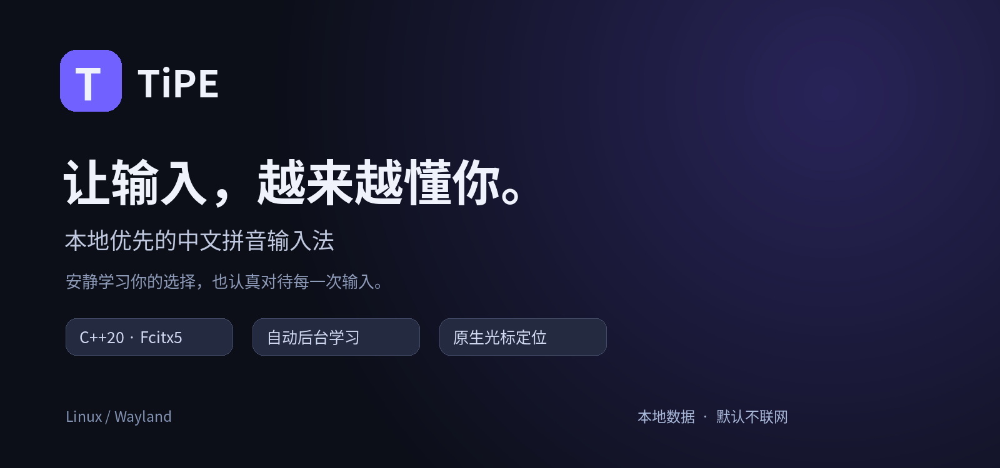
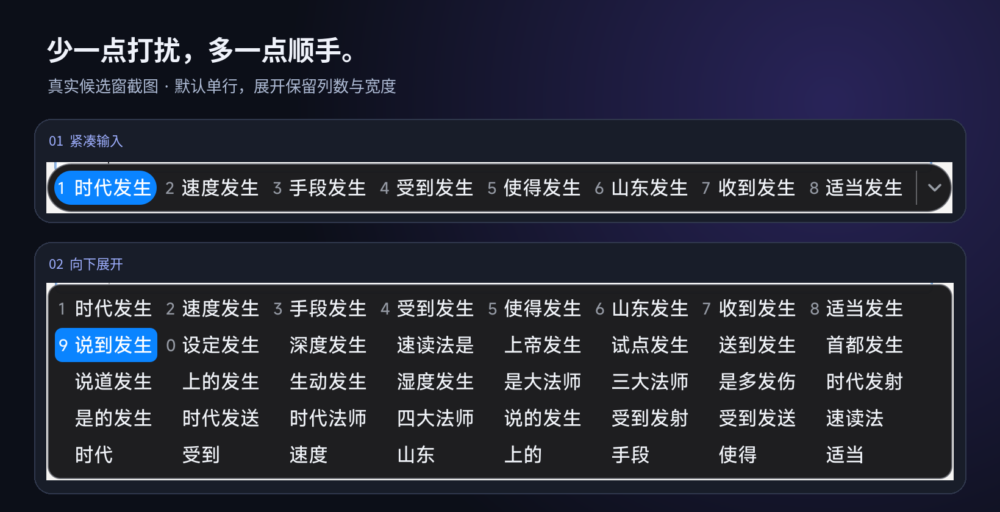
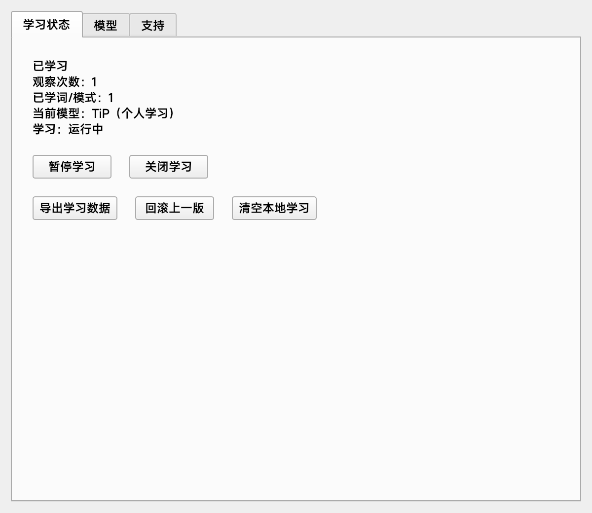

<div align="center">



**为 Linux 桌面打造，安静学习你的输入习惯。**

<p>
  
  
  
  
</p>

[开始使用](#开始使用) · [输入体验](#输入体验) · [自动学习](#自动学习) · [验证记录](#验证记录) · [支持开发](#支持开发)

</div>

TiPE 是基于 **Fcitx5 + LibIME** 的中文拼音输入法。成熟词库负责基础解码，个人学习负责逐渐理解你的选词、修改和输入习惯。按键、候选与学习分层处理，后台更新会自动生效，无需手动点击“训练”或重启输入法。

> 当前版本：**0.1.0 · 源码构建**。主要验证环境为 Fedora、niri / Wayland；候选窗的一致外观需要配套的 GTK / Qt / Fcitx 前端补丁，目前没有一键安装包。

## 输入体验



| 你在做什么 | TiPE 的行为 |
| --- | --- |
| 正常输入拼音 | 稳定的预编辑文本，使用 LibIME 词典和语言模型提供候选 |
| 查看更多候选 | 方向键 / Tab 展开；保留原来的列数、列宽与窗口宽度 |
| 输入长句、逐段选词 | 已选前缀提交，剩余拼音保留；长组合按真实词边界继续解码 |
| 编辑或切换语言 | 支持组合内光标、插入和删除；轻按 Shift 暂存组合并切换中英文 |
| 输入英文、代码或网址 | 提供原文候选，支持大小写与可撤销的个人原文偏好 |
| 在不同应用打字 | GTK、Qt 与原生 Wayland 共用绘制器，以协议光标矩形定位 |

**常用按键**：`Space` 选择候选 · `Enter` 提交原文 · `Shift` 中英切换 · `1–9 / 0` 选择当前编号组 · `PageUp / PageDown` 翻页。

更多操作见 [白话用户说明](docs/USER_GUIDE.zh-CN.md)。

## 自动学习

TiPE 从选词、删除重输、编辑和完整选择链中积累证据。例如输入 `woc` 后依次选择“我”和“操”，后台会保留完整链，而不只关注最后一次空格。

```text
输入与选词  →  有界语义事件队列  →  低优先级后台整理
                                          ↓
后续输入自动使用新版本  ←  校验、原子发布与可回滚模型
```

| 模型 | 做什么 | 默认状态 |
| --- | --- | --- |
| **TiP 个人层** | 学习明确选词、精确拼写、分段选择链和有置信度的纠错模式 | 启用 |
| **本地小模型** | 在本机学习汉字搭配，辅助低位候选排序；属于统计模型 | 可选 |
| **云端大模型** | 后台发送最小化语义请求，经过校验后临时补充候选 | 关闭，需配置与明确同意 |

基础词库与个人数据分开保存。泛化纠错只在基础结果很弱时介入，不能随意覆盖正常整句。事件队列最多 **2048** 项，学习失败自动重试；网络和模型发布不在按键线程运行。

### 数据由你控制

- 默认在本机保存，不上传原始键盘流或整段周围文本。
- 标记为密码或敏感用途的输入框不进入学习；无法可靠识别密码的 XIM 路径默认关闭学习。
- 控制中心提供 **暂停、关闭、清空、导出和回滚**，无需训练按钮。
- 云端需要显式配置与同意，发送范围和状态在模型页说明。

<details>
<summary><b>查看学习状态页</b></summary>
<br>

</details>

## 开始使用

### 1. 构建核心

需要 C++20 编译器、CMake ≥ 3.20、Ninja、pkg-config、Fcitx5 开发文件和 OpenSSL。完整候选绘制还需要 Pango/Cairo；建议安装 **LibIME 及词典/语言模型数据**，Qt6 Widgets / Network 用于控制中心。

Fedora 的核心依赖示例：

```bash
sudo dnf install gcc-c++ cmake ninja-build pkgconf-pkg-config \
  fcitx5 fcitx5-devel libime-devel libime-data \
  openssl-devel pango-devel cairo-devel \
  qt6-qtbase-devel gtk4-devel

git clone https://github.com/meovv-w/TiPE.git
cd TiPE
cmake -S . -B build -G Ninja -DCMAKE_BUILD_TYPE=Release
cmake --build build -j4
ctest --test-dir build --output-on-failure
```

确认发行版同时提供 LibIME 的 `sc.dict` 与 `zh_CN.lm`；不同发行版可能将语言模型单独打包。缺少数据时有诊断和小词表回退，但体验不等同完整词库。

### 2. 构建候选窗前端

**仅编译核心不包含截图中的完整跨应用样式。** 需要按使用场景构建对应前端，补丁基于固定上游版本，产物安装到用户目录。

| 输入路径 | 构建入口 | 说明 |
| --- | --- | --- |
| 原生 Wayland、X11 / Wine | `./integration/build-classicui-grid.sh` | 固定 Fcitx 5.1.21；提供 classicui 和 waylandim |
| GTK3 / GTK4 | `./integration/build-gtk-painter.sh` | 构建应用内候选窗；[GTK 说明](integration/GTK-PAINTER.zh-CN.md) |
| Qt6 | `./integration/build-qt6-tipe.sh` | 需要与本机 Qt 匹配的私有开发文件 |

完整依赖、路径覆盖与安装方法见 [前端集成](integration/README.md)、[GTK / Qt 安装说明](docs/INSTALL.zh-CN.md) 和 [协议与回退](docs/FCITX-WAYLAND-ADAPTER.zh-CN.md)。

### 3. 预演、安装与启用

```bash
# 先查看安装计划
./scripts/install-preview.sh build

# 使用实际 classicui 构建产物的路径；相邻 waylandim 会一并安装
TIPE_CLASSICUI_SO="${XDG_CACHE_HOME:-$HOME/.cache}/tipe/fcitx5-classicui/build/bin/libclassicui.so" \
  ./scripts/install-user.sh build

# GTK / Qt 前端另按集成文档安装，然后启用 TiPE
./scripts/activate-user.sh
```

启用脚本会备份 profile，并重启当前用户的 Fcitx。安装器保留原文件备份、原子替换模块，**不修改 niri 配置或快捷键**；已有 `fcitx5.service` 时保存专用加载配置，使下次登录仍能加载用户模块。没有该服务的桌面通过 `scripts/run-user-fcitx.sh` 启动。

打开控制中心：`~/.local/bin/tipe-control`。已运行的 GTK / Qt 应用需要在方便时重新打开，才能加载新模块。

<details>
<summary><b>卸载与恢复</b></summary>

```bash
./scripts/uninstall-user.sh --dry-run
./scripts/uninstall-user.sh
```

卸载按清单恢复或移除安装文件，保留用户后续修改、个人学习和备份。若要删除学习数据，可先在控制中心点“清空”。

</details>

## 验证记录

以下为 **2026-10-23 本机保存的验证结果**，不是 GitHub CI 或所有环境的兼容承诺。

| 验证 | 结果 | 范围 |
| --- | ---: | --- |
| 完整 CTest | **36 / 36** | 状态机、学习、隐私、云端协议、资源、UI 与安装事务 |
| 实际编辑 | **98 / 98** | GTK、Qt、Chromium、Wine、foot |
| 分段输入 | **43 / 43** | 前缀选择、剩余拼音、恢复与中英往返 |
| 安装版 niri 缩放 | **64 / 64** | 私有单输出会话，1× / 1.25× / 1.5× / 2× |
| 启动与安装回归 | **3 / 3** | 映射核对、安装事务和启动竞态 |
| 收款码与控制中心 | **4 / 4** | 原图资源、查看大图、窄窗口与 HiDPI |

代表性重复采样：5000 次单键 **p95 约 0.39–0.44 ms**，242 字节组合中间编辑 **约 4.07–4.14 ms**。保留了首次异常慢采样，不保证任意负载下都低于 5 ms。

[验收范围与限制](docs/ACCEPTANCE.md) · [结构化证据清单](docs/evidence/2026-10-23/current-results.json) · [架构与交付说明](docs/DELIVERY.zh-CN.md)

### 使用前了解

- **Wine / XIM**：中文输入可用；因缺少密码标记，观察、个人学习和云端默认关闭。光标跟随可能需要可恢复的 [按应用 overthespot 配置](docs/WINE.zh-CN.md)。
- **协议能力**：未收到用途的 Wayland 字段暂时按原文输入且不学习；删除恢复和最终保留确认依赖客户端周围文本能力。
- **验证边界**：实体 niri 多屏、Discord 登录聊天界面没有取得验证；隔离多屏或 Electron 夹具结果不能替代它们。
- **可选云端**：本地 HTTP(S) 服务契约已测试，尚未配置外部生产服务。[云端配置](docs/CLOUD-TRANSPORT.zh-CN.md)

## 项目结构

```text
include/tipe/   核心、候选与学习接口
src/           C++20 状态机、LibIME、模型、绘制与控制中心
integration/   固定版本的 Fcitx / GTK / Qt 前端补丁
packaging/     元数据、图标、主题与支持图片
scripts/       安装、恢复、诊断和实际应用验证
tests/        状态机、质量、隐私、生命周期与资源回归
docs/         中文说明、截图与验证证据
```

开发入口见 [贡献指南](CONTRIBUTING.md)，详细命令见 [开发与验证参考](docs/DEVELOPMENT.zh-CN.md)。

## 支持开发

如果 TiPE 对你有帮助，欢迎支持它的持续开发。以下收款码与控制中心“支持”页一致，点击可查看原图。

<table>
  <tr><th align="center">微信</th><th align="center">支付宝</th></tr>
  <tr>
    <td align="center"><a href="packaging/support/wechat.jpg"></a></td>
    <td align="center"><a href="packaging/support/alipay.jpg"></a></td>
  </tr>
</table>

---

<div align="center">

**TiPE · 让每一次输入，积累成更顺手的下一次。**

[使用说明](docs/USER_GUIDE.zh-CN.md) · [报告问题](https://github.com/meovv-w/TiPE/issues/new/choose) · [安全说明](SECURITY.md)

</div>
